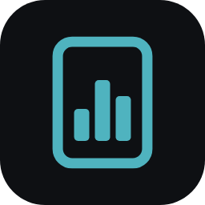

# Sideslate

Sideslate turns an old Android tablet or phone into a live dashboard for your Windows PC, over your own Wi-Fi.

Put the tablet next to your monitor and choose the tiles you want: CPU, GPU and RAM load, GPU temperature, FPS of the
game you're playing, top processes, what's playing in Spotify or the browser, your game time this week, plus a clock,
calendar, weather, notes, a timer and stock prices. The clock, calendar, weather, notes and timer also work when the PC
is off.

**Status: early beta.** Expect rough edges, and please [report them](https://github.com/sideslate/sideslate/issues).

## Download

You need two things: **Sideslate PC** on the PC you want to watch, and **Sideslate** on the tablet or phone.
Each link downloads the newest version straight away.

| | Download |
|---|---|
| **Your Windows PC** (Windows 10 or 11, 64-bit) | **[⬇ Sideslate PC for Windows](https://github.com/sideslate/sideslate/releases/latest/download/Sideslate-PC-windows-x64.zip)** |
| **Your Android tablet or phone** (Android 6.0 or later, 32-bit devices too) | **[⬇ Sideslate for Android](https://github.com/sideslate/sideslate/releases/latest/download/Sideslate-android.apk)** |
| A second Windows device used as the dashboard | [Sideslate for Windows](https://github.com/sideslate/sideslate/releases/latest/download/Sideslate-Display-windows-x64.zip) |
| Linux (experimental, never run on a real Linux desktop) | [Sideslate PC](https://github.com/sideslate/sideslate/releases/latest/download/Sideslate-PC-linux-x64.tar.gz) · [Sideslate](https://github.com/sideslate/sideslate/releases/latest/download/Sideslate-Display-linux-x64.tar.gz) |

Nothing else has to be installed; .NET is included in every download. What's new, older versions and the checksums
(`SHA256SUMS.txt`) are on the [release page](https://github.com/sideslate/sideslate/releases/latest).

## Install

1. **On the PC:** unzip `Sideslate-PC-windows-x64.zip` into a folder where it can stay, and start `SideslatePC.exe`.
   - Windows may say "Windows protected your PC", because the file is not signed yet. Choose **More info**, then
     **Run anyway**. Compare the file with `SHA256SUMS.txt` on the release page if you want to be sure it's the
     original.
   - Allow it when the firewall asks (private networks are enough).
   - A small window at the bottom right says that Sideslate PC runs. It then stays in the background with an icon in
     the corner of the taskbar. **Windows 11 hides new icons under the ^ arrow** next to the clock; drag the icon onto
     the taskbar to keep it in view. Right-click the icon to quit.
   - To update later, unzip the new version and start it: it closes the older copy by itself.
2. **On the tablet or phone:** open the `.apk` and allow installing from this source when Android asks.
3. **Open Sideslate.** It searches for your PC by itself. Tap your PC when it appears and type the code that pops up on
   the PC. Both devices must be on the same Wi-Fi.

No PC? Choose **Use without a PC** and use the clock, calendar, weather, notes and timer on their own.

## If the PC is not found

- Check that Sideslate PC is running (its icon is in the corner of the taskbar, maybe under the **^** arrow) and that
  the firewall allowed it.
- Guest Wi-Fi networks often stop devices from seeing each other. Use your main network.
- Some networks block the search. On the tablet, choose **Enter the PC's address** and type the address that the PC
  shows when you right-click the Sideslate PC icon (for example `192.168.1.20`).

## FPS counter (optional)

The FPS tile uses Intel's open-source PresentMon, which comes with Sideslate PC and only runs while an FPS tile is on a
connected tablet. Windows needs a one-time permission: right-click the Sideslate PC icon, choose
**Allow FPS counter...**, approve the administrator prompt, then sign out of Windows and back in. Some games with
anti-cheat software block this kind of reading; nothing is injected into the game.

## Privacy and security

- Everything stays on your own network. There is no account, no cloud service and no telemetry.
- Sideslate only goes to the internet for the tiles you add: weather (Open-Meteo), stock and crypto prices (Yahoo
  Finance), GitHub (the developer tiles), and the addresses you type into the Ping and API health tiles.
- A tablet has to be paired with a code shown on the PC before it can see anything.
- The connection inside your network is plain HTTP, so don't use it on a network you don't trust.

## Uninstall

- **PC:** right-click the Sideslate PC icon, untick **Start with Windows**, choose **Quit**, and delete the folder.
  Paired tablets, game time and logs are in `%APPDATA%\PcAgent1`; delete that folder too to remove everything.
- **Tablet or phone:** uninstall the Sideslate app.

## Feedback

Found a bug or missing something? [Open an issue](https://github.com/sideslate/sideslate/issues/new/choose). Please
say which release you downloaded; Sideslate PC also shows its version at the top of its icon's menu.

Sideslate is free to use. The source code is not public; this repository holds the downloads and the issue tracker.
